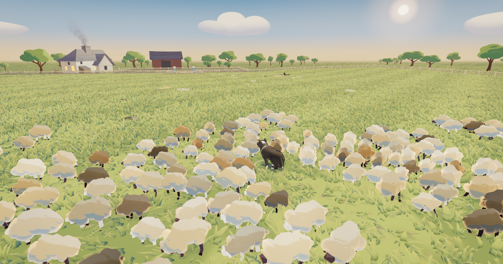

# Sheepdog Sim

One dog, one flock, one field. A calm, cel-shaded browser game about guiding
sheep through a pasture gate. Get behind the flock, move patiently and use a
well-timed bark to bring stragglers home.

**[Play Sheepdog Sim](https://sheepdogsim.com)** ·
[Controls and help](https://sheepdogsim.com/support) ·
[Report a bug](https://github.com/matthew-kissinger/sds/issues)



## In the field

- Choose a flock of **25, 75 or 200 sheep** and guide every sheep into the pen.
- Move, sprint and bark with keyboard, gamepad or touch controls.
- Switch between the overhead **Classic** camera and the closer **Follow** view.
- Find the entrance through an in-world highlight and an offscreen direction cue.
- Personalize your dog’s coat and name, choose flock breeds and name individual
  sheep in **Studio**. Compact phone controls leave room for the animal preview;
  larger screens use a side panel.
- Explore a golden-hour field with dense grass, authored trees, moving clouds,
  an animated farmhand and a quieter, spatial soundscape.
- Keep local personal bests and optionally compare online solo times for each
  flock size. Edit the running name assigned to your device.

Online identity and score requests are fail-soft. Play, completion and local
personal bests continue when the score service is unavailable.

No account is required to play. Solo, co-op and shared-flock competitive are
available; multiplayer supports two to four players through invite links and
regional public lobbies. Campaign and survival modes are not included.
See [multiplayer development](realtime/README.md) for local play and the
persistent history/owner-dashboard candidate.

## Controls

| Action | Keyboard | Gamepad | Touch |
| --- | --- | --- | --- |
| Move | W A S D or arrows | Left stick | Left joystick |
| Sprint | Shift | Right trigger or A / Cross | Sprint button |
| Bark | Space | B / Circle or X / Square | Bark button |
| Change camera | C | Y / Triangle | Camera button |
| Pause | Escape or pause button | Use the on-screen pause button | Pause button |

After stamina runs out, release Sprint and press again to start another sprint.
Holding it down through recovery does not automatically restart it. Partial
stick movement provides a slower walking pace.

Settings includes keyboard remapping, reduced motion, quality, audio levels and
a colorblind dog marker. In Studio, drag the preview or use the orbit controls;
choose a camera preset to inspect the dog from another angle.

## Run locally

Requirements:

- Node.js 22 or newer;
- a current browser with WebGPU or WebGL2.

```bash
git clone https://github.com/matthew-kissinger/sds.git
cd sds
npm ci
npm run dev
```

Open the local URL printed by Vite.

`npm run dev` also runs the score API: the Cloudflare Vite plugin serves the
Worker from `app/cloudflare.config.ts` beside the client on the same origin,
with no proxy and a local D1 under `.wrangler/state`. The API needs a local secret and
database once:

```bash
cp .dev.vars.example .dev.vars         # local JWT_SECRET, gitignored
node scripts/d1-local-setup.mjs        # once, for a fresh local database
```

Without them the game runs and the online boards report unavailable.

[docs/operations/deployment.md](docs/operations/deployment.md) has the local
workflow in full.

Useful commands:

```bash
npm test
npm run lint
npm run typecheck
npm run typecheck:worker
npm run build
npm run preview
npm run probe:boot
npm run probe:release
npm run check:discovery
```

Run `npm run build` before the preview and built-artifact checks. See
[the testing guide](spec/09-testing.md) for validation expectations.
Current evidence and remaining device
or performance limitations are tracked in [STATUS.md](STATUS.md).

## Architecture

The application is split into four deliberate boundaries:

```text
sim/       deterministic fixed-step herding simulation
app/       React Three Fiber, Three.js, input, audio and player interface
assets/    runtime assets plus editable sources and bake manifests
tools/     deterministic bakes, diagnostics and release verification
worker/    identity and score API; also serves the built client as static assets
```

The simulation imports no Three.js, React, DOM or network code. The renderer
uses one TSL material path for WebGPU and WebGL2. Zustand is the shared state
authority for the scene and player interface.

The field is assembled from reproducible source:

- terrain, grass, treeline and scatter placement are deterministic bakes;
- the active treeline is an original, procedurally authored sculpted-oak family,
  baked into instanced geometry with no external model loading;
- sheep, the skinned dog and farmer, fences and farm structures are code-authored;
- material and atmosphere systems are TSL source;
- every audio file is a committed, provenance-tracked source with its provider,
  prompt, processing, duration, size and digest recorded in the audio ledger;
- authoring concepts are retained separately from runtime assets.

Read [the version 3 architecture reset](docs/architecture/v3-reset.md) for what
was retained from version 2, what was removed and why the codebase was rebuilt.
Asset-specific recipes and provenance are documented under [assets/](assets/),
including [trees](assets/treeline/README.md), [dog](assets/dog/README.md),
[farmer](assets/farmer/README.md) and [audio](assets/audio/README.md).

## Release discipline

Production deploys use the [Deploy workflow](.github/workflows/deploy.yml),
triggered by a release tag on a commit already on `main`, and the procedure is
[docs/operations/deployment.md](docs/operations/deployment.md). One Cloudflare
Worker serves the game and its score API on `sheepdogsim.com`, so one deploy
ships both from the same commit. The workflow installs dependencies, runs lint,
typechecks, tests and the build, archives the artifact, deploys, then verifies
the live release, the API and the discovery pages.

Contributor checks additionally cover:

- deterministic fixtures and a running production preview;
- a built-artifact scan that checks the declared production multiplayer
  surface and excludes deferred scale and development-only code;
- complete 25, 75 and 200 sheep runs on both renderer backends;
- desktop and mobile interaction, layout and audio checks;
- asset source, license, secret and local-artifact checks;
- release and rollback procedures for the static client.

The deployed [release manifest](https://sheepdogsim.com/release.json) records
the source commit and artifact identity. Device coverage and performance numbers
in [STATUS.md](STATUS.md) describe measured configurations, not a guarantee for
every phone or PC. Production publication requires owner approval.

Production serves the multiplayer client with a separate realtime Worker at
`/r/*`. Solo-time boards keep the existing `field-v3` partition; multiplayer
history uses a separate database. The 5,000-sheep experiment remains excluded.

## Contributing

Start with [CONTRIBUTING.md](CONTRIBUTING.md), then read
[AGENTS.md](AGENTS.md) and the relevant document under [spec/](spec/). The spec
is the product contract. When implementation and spec disagree, document the
decision rather than adding a compatibility branch.

Bug reports should include the browser, device, renderer backend, flock size,
seed when known, reproduction steps and console output. Security issues should
follow [SECURITY.md](SECURITY.md).

## License

Source code is licensed under
[GNU AGPL-3.0-or-later](https://www.gnu.org/licenses/agpl-3.0.html), copyright
Matthew Kissinger.

Runtime and authoring assets are covered by the asset ledger and
`LICENSE-ASSETS`. Do not assume a code license applies to third-party or
generated media. Hosted modified versions must provide corresponding source and
retain the applicable notices.
