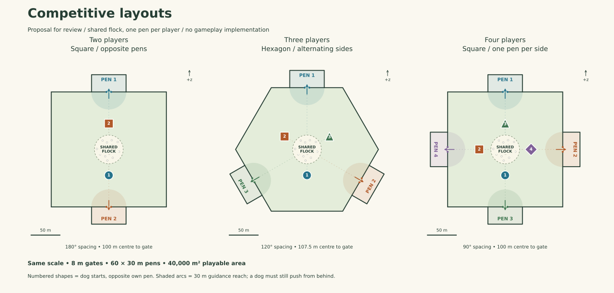
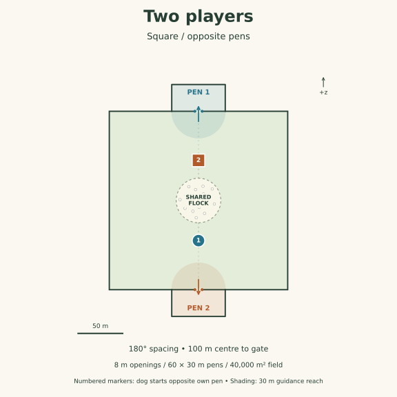
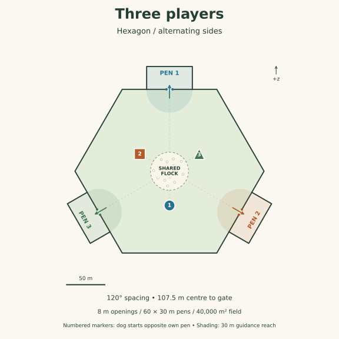
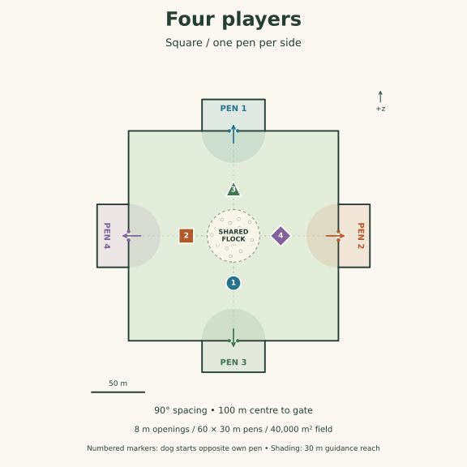

# Competitive layout review

2026-10-20. **Proposals for owner review, not approved gameplay or implemented
layouts.** The settled rules remain in [the plan](multiplayer-plan.md). These
are scaled engineering diagrams, not screenshots or new runtime assets.

## Recommendation

Use the existing 200 x 200 m square for two and four players. For three players,
use a regular hexagon with gates on alternating sides. It is the smallest
change here that gives three players equivalent straight fence approaches
without acute triangular corners. The hexagon keeps 40,000 square metres of
playable area, matching the square; its gates are about 7.5 m farther from the
centre. This is a competitive layout variation within the same field art,
not a change to solo or co-op.

## Shared dimensions and rules

- One shared flock starts around the centre. Candidate spawn envelope: radius
  25 m, matching solo's envelope size but centred for competition. Sheep dots
  in the drawings are illustrative, not a seeded spawn or placement algorithm.
- Every opening is 8 m wide. Each outside pen is 60 m across and 30 m deep,
  reusing solo's dimensions, rotated to face its approach. Each pen must be able
  to receive the entire selected flock; equal dimensions alone do not prove
  settlement works for 200 sheep.
- Dog start markers sit 45 m from the centre, opposite their own pen, facing
  the flock. This gives each player the same initial opportunity to push toward
  their own goal, with at least 20 m to the spawn envelope. Dogs can move
  anywhere in the playable field; the dotted axes are not lanes or boundaries.
- Shaded semicircles show the existing 30 m gate-guidance range, clipped to the
  field. They do not pull sheep by themselves: Q12 still requires a nearby dog
  pushing from behind. Ownership and forfeiture never change guidance.
- Capture begins at the visible opening, using the 3.6.1 correction. No second
  hidden threshold. A forfeited pen remains open and later captures are unclaimed.
- Numbers and distinct dog-marker shapes supplement colour. These are diagram
  symbols; final above-player icons and pen labels still need UI review.
- Dimensions are starting proposals. Keep them fixed during initial comparisons;
  change them only through recorded gameplay review, not network tuning.

## Two players: opposite pens

North and south gates on the existing square, 180 degrees apart. Each gate is
100 m from the centre; each dog starts 45 m on the other side. This preserves
the simplest boundary shape and makes the contest easy to read.

**Risk:** two dogs approaching the same flock head-on can produce a standoff
or scatter along the east/west fences. Test normal move/sprint/bark with two
people before changing gate assistance. Do not add lane walls, a majority-win
shortcut or a timer to disguise that playtest result.

## Three players: alternating sides of a hexagon

Gates are 120 degrees apart, at the middle of alternating sides. The other
three sides remain solid fence. Every gate has the same two neighbouring
120-degree corners and the same straight approach. Dog starts are opposite
their own gates, toward the solid sides.

For area A = 40,000 m², the centre-to-side distance is
`a = sqrt(A / (2 * sqrt(3))) = 107.457 m`. Each side is 124.081 m;
the field envelope is 248.161 m wide by 214.914 m deep in this orientation.
Gate centres in (x, z), with +z at the top of the drawing:

| Pen | Gate centre, m | Dog start, m |
| --- | --- | --- |
| 1 | (0, 107.457) | (0, -45) |
| 2 | (93.060, -53.728) | (-38.971, 22.5) |
| 3 | (-93.060, -53.728) | (38.971, 22.5) |

**Tradeoff:** this needs a convex field boundary and oriented pen coordinates;
the current simulation assumes an axis-aligned rectangle and one north gate.
Terrain/grass footprint, fence joins, scatter and camera clearance also need
layout-aware review. No new mesh is proposed, but this is real implementation
work. Retain a separate unchanged solo path and fixtures.

**Rejected as the default:** north/east/west gates on the square. The north
player has two adjacent rivals, while east and west are opposite each other;
equal centre distance cannot make those boundary relationships equivalent.
A triangle has exact three-way symmetry but sharper corners and longer wall
funnels. A circular field avoids corners but adds curved-boundary/fence work.

## Four players: one pen per side

North, east, south and west gates on the existing square, 90 degrees apart.
Each gate is 100 m from the centre. All players have two adjacent opponents
and one opposite opponent. Each dog starts on the opposite side from its pen.

**Risk:** the central contest is denser, and two adjacent opponents can pressure
one player. Geometry cannot remove teaming or equalise player skill. Test
four-person readability, late stragglers and multiple barks; do not shrink
the field or enlarge the openings without a separate gameplay decision.

## Geometry checks, not fairness certification

| Candidate | Playable area | Centre to gate | Minimum gate-centre separation | Gap between 30 m guidance circles |
| --- | --- | --- | --- | --- |
| Two-player square | 40,000 m² | 100 m | 200 m | 140 m |
| Three-player hexagon | 40,000 m² | 107.457 m | 186.121 m | 126.121 m |
| Four-player square | 40,000 m² | 100 m | 141.421 m | 81.421 m |

All proposed guidance zones are disjoint, even before clipping to the field.
Equal openings, pen dimensions, dog radii and rotational boundary symmetry
are geometric facts. They do not prove equal win rates or equal camera views.

## Adversarial review and acceptance work

1. **The initial sheep can break symmetry.** A random centred flock is balanced
   only in distribution. Exact rotational copies do not divide all allowed
   flock counts evenly: 25, 75 and 200 cannot all be partitioned into equal
   two/three/four-way orbits without special centre placements. Avoid overlapping
   sheep or changing the allow-list to force symmetry. Compare candidate seeded
   spawns by per-pen distances and starting pressure; rotate player-to-slot
   assignments across matched-seed tests. Do not promise perfect fairness for
   every single seed.
2. **A compass direction can be easier to see.** Compare each seat in Follow
   and Classic, desktop and portrait, including first input and a full gate
   approach. A symmetric map does not make the shipped north-oriented camera
   or gate indicators symmetric. Review a local-player-relative initial framing
   without silently changing control mapping or camera behaviour.
3. **The current homestead is north-biased.** Keep buildings and trees out of
   every pen, approach and camera clearance zone. Do not merely duplicate the
   house behind every pen. Review existing scenery placement from all seats;
   keep the same art kit and propose any new asset need before authoring.
   Terrain relief is visual, but it can still hide a dog or gate.
4. **Fence symmetry can hide collision asymmetry.** Exercise rotated crossings,
   oblique approaches and pen corners using the same geometry as the drawing.
   Test every pen with 200 sheep, plus forfeited pens and the final unclaimed
   sheep. An oriented rectangle must not become an oversized axis-aligned
   capture box at a diagonal hexagon gate.
5. **Guidance must stay neutral.** Swap identities and eligibility while holding
   positions/inputs fixed. Motion must match. Keep the general overlap and
   equidistant tests even though these initial guidance circles do not overlap.
6. **Balanced distances do not predict fun.** Two-player standoffs, three-player
   temporary alliances and four-player central congestion need independent
   human playtests. Record the results separately from networking performance.

Co-op continues to use the existing square and one north pen for two to four
players. It does not adopt these competitive pen arrangements.

Review now: accept or revise the square / hexagon / square direction and the
opposite-pen dog starts. Approval of these drawings would select a prototype
direction, not close gameplay, visual or device acceptance. Implementation
still requires the owner's instruction.
