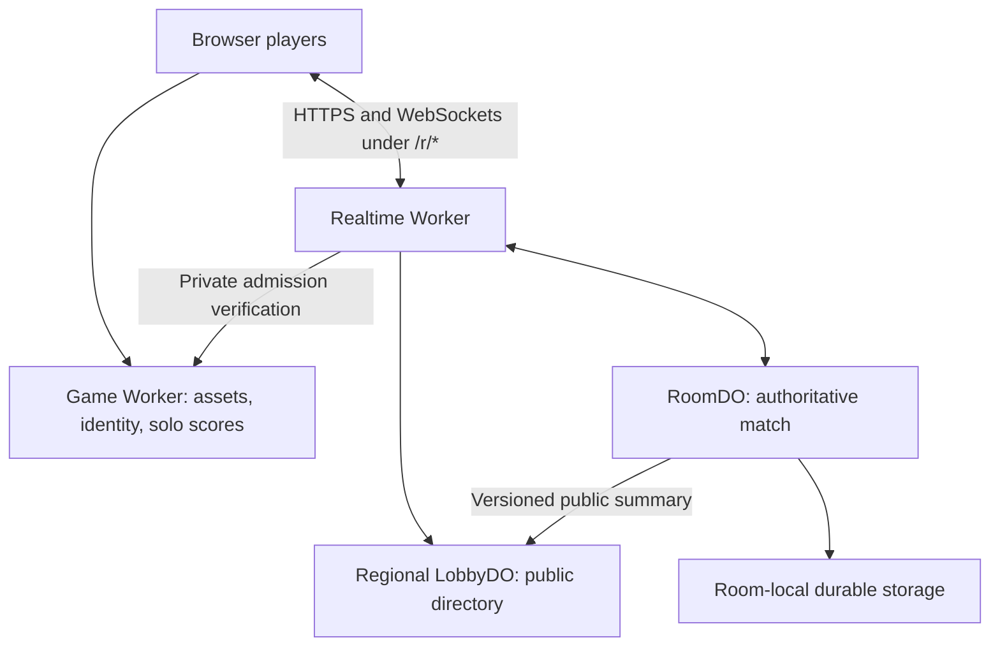

# Multiplayer plan

**Current amendment, 2026-10-21:** co-op and competitive shipped in 3.8.0.
The owner has now authorized persistent match history, separate player stats
and a read-only owner dashboard. [Spec/03](../../spec/03-multiplayer.md#persistent-history-and-activity---owner-directed-2026-10-21)
defines the dedicated D1, durable outbox and private query contract; the
[setup note](../operations/multiplayer-history.md) records access and rollout
requirements. This supersedes the earlier deferred-D1 result-storage boundary
below. No ranked ladder, solo migration, new assets or gameplay change is part
of this slice. Dated planning gates below retain their original context;
[STATUS](../../STATUS.md) is authoritative for current delivery state.

2026-10-20. Status: **co-op production release authorized after the hosted PC/hub smoke**.

The owner requested this plan after score cards shipped, selected shared-flock
competition with one pen per player, and accepted regional public boards with
host-controlled starts. The owner subsequently authorized local implementation
and tests, with staging setup and costs to be reviewed before provisioning.
The owner subsequently approved the bounded staging pilot and then production
co-op deployment, including its hosting and release workflow. Competitive remains
planned. Remaining qualification work does not block this initial release.
It is the execution plan; [spec/03](../../spec/03-multiplayer.md) is the product
and service contract, [spec/09](../../spec/09-testing.md) the acceptance matrix,
and [STATUS](../../STATUS.md) the current work boundary. Earlier discussion and
historical plans are evidence, not permission to start a stage.

Current implementation: [local realtime service](../../realtime/README.md).
The local host now runs the shared Home Field simulation and the normal client
renders two to four dogs. It covers movement, bark, reconnect, continue-on-leave,
shared results and host-controlled rematch. The production candidate exposes Play co-op.
The local pilot uses full snapshots and fixed 100 ms interpolation; delta
compression/adaptive buffering, competitive and the full acceptance matrix are
still outstanding. These reversible choices do not close Stage 2 or Q8.
The [staging setup and estimate](../operations/multiplayer-staging.md) assumes
the owner-confirmed Workers Paid account. The owner approved $20; allowance
balance remains unverified. Staging was deployed and the hosted PC/hub smoke
passed; the owner then requested production promotion.

## Decisions and limits

Agreed scope: private invite rooms; public boards by selectable region; up to
four people; co-op sharing one pen; competitive sharing the flock with one pen
per player; host chooses when to start; parties can rematch. Same field art,
same move/sprint/bark verbs, 25/75/200 sheep. Cross-region invitations remain
possible. No NPC fill, spectators, chat, voice, ranked ladder or new biome.

Chosen design: a separate realtime Cloudflare Worker, one RoomDO per room and
one LobbyDO per region. Cloudflare runs the simulation; the lobby host is only
a player with settings/start authority. Keep identity and solo results with
the existing game Worker. Use a narrow service binding for identity admission
instead of distributing its signing secret. No multiplayer score enters
`field-v3` solo boards. Reuse current assets before proposing new ones.

The owner settled competitive departure on 2026-10-20: forfeit and continue,
as specified under "Settled decisions" below. This replaces the earlier
proposal to cancel everyone's round after one permanent departure.

Competitive scoring is also settled: finish the flock, highest eligible count
wins, shared ties. The layout direction and dog starts were accepted after
review on 2026-10-20; implementation and playtest qualification remain unopened.

The [competitive layout review](multiplayer-layouts.md) now illustrates
opposite pens on a square for two players, alternating sides of a regular
hexagon for three, and four sides of a square for four. These are proposed
geometry accepted as the prototype direction on 2026-10-20. Dogs start 45 m
from the centre opposite their own pen. This is not fairness certification or
implementation authorization.

The owner answered Q1-Q12 below. Product policies are settled; layout evidence,
placement coverage, numerical transport limits and the staging cost estimate
remain engineering gates. None of these answers authorize implementation.

## What exists now

Read-only inspection on 2026-10-20 found:

- Checkout `a5877989`; the live release endpoint reported 3.6.0,
  `ee8086a9d8397de12dfbe31515ee6b0d56073ee1`. `/api/healthz` returned JSON
  identifying `sds-worker`. These are dated observations, not an evergreen
  deployment assertion or a complete Cloudflare account audit.
- The separately authorized solo gate correction subsequently shipped as
  3.6.1 (`32e720a7`, 2026-10-20). Pen retirement now begins at the visible
  opening; its unchanged-art and trace evidence is in the status log. Use this
  corrected solo baseline for multiplayer work. It introduces no rooms or
  multiplayer guidance implementation.
- `app/cloudflare.config.ts` declares the apex Custom Domain, assets, score
  API, score cards and separate preview data. `/r/*` is reserved, not deployed
  as multiplayer. The old room classes were removed with the v3 hosting work.
- `sim/step.ts` iterates dogs and accepts one input per dog, but `sim/state.ts`
  creates one dog. `sim/types.ts`, boundary handling and PenBarrier assume one
  gate/pen. `app/src/game/useGameLoop.ts`, `scene/Dog.tsx`, camera, input, audio
  and other consumers still need a local-player/remote-player audit.
- `sim/FlockSim.ts` exposes multi-dog arrays but only the latest accepted bark.
  Concurrent barks need an event contract; adding dogs alone loses presentation
  events. `sim/rng.ts` keeps its cursor inside a closure, so seed-only recovery
  is not a checkpoint of a running game.
- `scene/fenceGeometry.ts` supports cardinal openings, while
  `scene/fence/fieldSections.ts` binds the shipped single north gate. This is
  reusable geometry machinery, not proof that a competitive layout is fair.
- The configured `ssh hub` attempt timed out in the scoping session. Existing
  hub probes are available. A later gate-fix check on 2026-10-20 reached `mk-os`
  over that alias; this confirms access only, not multiplayer performance.

## Lessons from earlier iterations

Inspect immutable refs with `git show <tag>:<path>`; do not restore v2 source
into the live client. Both v1.5.0 and v2.6.4 contain the Durable Object design.
The following conclusions come from code/tests, not a claim that an old live
multiplayer release has been replayed and qualified today.

| Evidence at v2.6.4 unless stated | Keep | Change or avoid |
| --- | --- | --- |
| v1.5.0 `worker/wrangler.toml`, `worker/src/RoomDO.ts`; v2 `RoomDO.ts`, `LobbyDO.ts` | One server authority per room; central admission and directory | Split realtime deployment from site/score deployment; partition directories by region |
| `worker/src/RoomDO.ts` constructor and `persist()` | Identity-bound membership, durable lobby state | The constructor resets an in-game room to waiting because the sim is lost. Never describe that as full match recovery |
| `worker/src/index.ts`, `jwt.ts`, `RoomDO.ts` | Verified identity, short admission, reconnect seat reclaim, input validation | No direct DO admission bypass; no new identity after a room-service error; no legacy unauthenticated fallback |
| `worker/src/GameSim.js`, `applyPlayerInput` | Reject non-finite input and stale sequences | The client stop-position correction lets client coordinates affect authority. New protocol sends intent only |
| `RoomDO.ts`, `tests/worker/delta-*.spec.ts`, `tests/delta-client-reconstruction.spec.ts` | Broadcast-basis correctness, keyframe recovery, bounded parsing and slow-client handling | One protocol version; no permanent legacy cohorts; measure current wire sizes and runtime backpressure support |
| `docs/hardening/delta-protocol-design.md` | Concrete bandwidth arithmetic and explicit recovery cases | It describes the pre-implementation baseline. Historical savings and 200-sheep record sizes are not v3 measurements |
| `shared/CompetitiveLayout.js`, `CompetitiveMode.js` | Shared flock with player-owned destinations; deterministic layout | One agreed finish rule for all party sizes; no player-ID tie winner; no assumption that three cardinal pens are fair |
| `docs/multiplayer-ux.md`, `js/multiplayer/MultiplayerCoordinator.js` | Invitation, readiness and host-handoff scenarios | No automatic public-room mode rotation; no parallel UI generations or bridge globals |
| `tests/e2e/mp/_helpers.ts` and invite/reconnect/soak specs | Independent browser identities and lifecycle scenarios | Helpers used `mpProbe`/`testNoCanvas`; those are not rendered-play evidence and must not return as production switches |

The current spec previously said to lift old constants without remeasurement,
assumed releases every few weeks, combined solo/co-op scores, and claimed
mid-game persistence. Those claims are superseded. The earlier decision to
rewrite the solo score service remains separate; multiplayer does not silently
expand into that migration or remove its newer score-card/history consumers.

## Architecture and regional discovery

The RoomDO owns seat allocation and transitions. Public directory counts are
advisory and may briefly lag. Atomically recheck join/start in the room; never
reserve the fourth seat only in the board. Use expiring directory entries,
revision checks and idempotent reconciliation. A failed lobby update cannot
pause sheep. A private room never leaks through activity counts or listings.

Begin with the three approved boards, not a mode x region x flock-size queue
matrix. Provisional placement mapping: North America -> `enam`, Europe ->
`weur`, Asia-Pacific -> `apac`. This is a test matrix, not a final coverage
promise; test western North America and Oceania explicitly before choosing
public labels. Only add another board when population and latency justify it.

The first lookup of a newly allocated room applies its location hint. A global
LobbyDO, CI runner or health probe must not accidentally instantiate every room
near itself. Include a validated region in the room handle so invites route
without a global code lookup; use sufficient random entropy, atomic init and
bounded collision retries. Placement hints cannot guarantee a city or move an
existing room. Measure application RTT to the room, not CDN edge latency [R3].

The region selector suggests the best of bounded regional probes, remembers an
explicit choice, and permits manual choice if probes fail. Show both modes on
one board with filters, occupancy and estimated connection quality. Empty
regions show public activity elsewhere without moving the player silently.
Opening a friend link can select another region with a warning. Handoff never
changes placement; changing region creates a new party room.

## Keep the implementation small

Future `realtime/` modules separate router/admission, room lifecycle, scheduling,
snapshot encoding and directory maintenance. Transport does not own game rules.
The client has one session lifecycle, with a local authoritative provider for
solo and a network snapshot provider for multiplayer. Both feed existing
presentation buffers. The local player is a stable seat, not always dog zero.
Predict that dog's movement with shared movement functions; interpolate the
flock and remote dogs. No duplicate simulation or full-flock lockstep [R9].

Co-op preserves the current one-pen field. Competitive adds a small explicit
layout/rules composition with pen ownership, not a scene registry or scattered
`isCompetitive` checks. Freeze roster and layout for the round. Multi-pen gate
attraction, crossing detection, settlement and dog containment use the same
geometry as the rendered fence. Keep current solo arithmetic and traces.

The public URL `/r/<room-handle>` requires an invite-shell handler: the realtime
route intercepts it before the game's SPA asset fallback. Serve that shell via
a narrow service binding, with root-relative assets; do not recursively fetch
the same routed URL [R4/R5]. Link previews perform no seat allocation. Room
REST/WS paths and their ticket parameters are not player-page query knobs.

## Staging and test plan

### Environments and candidate identity

Provision nothing during planning. After owner approval of implementation and
then of a concrete staging setup, use a stable staging game/identity Worker
plus a separate staging realtime Worker on one staging origin. Give it its own
DO namespaces, identity secret and D1 only where consumed. No production data
copy, shared room namespace or production identity binding. Inspect existing
stage hostnames before choosing one; the earlier hosting rehearsal is not an
available environment merely because its name appears in documentation.

Current ordinary PR version aliases are insufficient: Cloudflare documents
that version URLs are not generated for Workers implementing DOs [R6]. A
version URL also does not create a database isolation boundary. Start with
one explicitly deployed, serialized staging candidate. Per-PR environments are
a later option only with verified independent resources, TTL cleanup and an
actual need. Recheck newer platform preview features against installed tooling
at execution time instead of assuming the old alias workflow covers them.

Every receipt names client SHA, realtime SHA, protocol, rules/layout version,
schema version, environment, requested region, browser/renderer, player count
and flock size. Report requested placement and measured RTT separately; do not
invent a verified server city. Staging build uses the production build path
and normal UI, with environment configuration rather than extra query flags.

### Test layers

1. **Pure logic and real Workers runtime.** Add deterministic multiplayer traces
   alongside unchanged solo traces; test room/admission/directory invariants
   in the supported Cloudflare Vitest integration. Pin actual package versions
   when implementation starts. Current docs flag DO WebSocket incompatibility
   with per-file storage isolation: use the documented serial/shared-storage
   configuration for that suite, unique room IDs, and explicit cleanup [R7].
2. **Rendered functional staging.** Two people/clients first, then independent
   two/three/four-player browser identities on PC and hub. Open real invite
   links, create/join from each board, drive normal input, herd to completion,
   rematch, background, reconnect and leave. Do not use old no-canvas probes.
3. **Network and lifecycle faults.** Inject latency, jitter, packet loss at the
   network layer, bandwidth restriction and disconnects. WebSockets are ordered
   reliable transport: packet loss primarily creates stalls, not reordered
   application frames. Test delta-basis rejection separately. Force room
   restart, directory restart, site-only deploy, realtime drain/deploy and
   rollback; verify the documented outcome, identity continuity and no false
   score. No production test-only WS message types.
4. **Geographic and concurrency load.** Evaluate Grafana Cloud k6 for real
   regional WebSocket traffic [R8], using the normal identity/ticket protocol,
   the recommended `k6/websockets` API and a protocol-compatible binary codec.
   First prove that codec in the
   runner; use a small Node WS runner if it cannot run there. Cloud VUs check
   protocol and load, not rendered play. A hub Node runner is the inexpensive
   initial option; one network path cannot establish worldwide playability.
5. **Presentation and devices.** Desktop genuine WebGPU and forced WebGL2,
   mobile composition, real phone on Wi-Fi/cellular, simultaneous barks and
   multiple dogs. Independent visual/interaction/audio review follows AGENTS.md,
   including its five-iteration limit. Lab stills cannot pass motion.

Recheck hub access before scheduling measurements. It was reachable later on
2026-10-20 for the solo gate release; that is not multiplayer qualification.
Preserve others' jobs and
use isolated directories. Two consecutive <=5% GPU / <=15% aggregate CPU
preflight samples precede 60-600 s renderer timing runs. For the measured hub
browser, place the other rendered clients on other machines; four heavyweight
browsers on the hub are a stress case, not the single-client baseline. Keep
long protocol soaks separate from renderer timing. Clean up pages, profiles,
listeners, servers and test rooms. Preserve only useful receipts outside git.

### Candidate experiments, not passed budgets

Start with 60 Hz simulation, 30 input packets/s and 20 snapshots/s; compare
15/20/30 snapshot rates if evidence warrants it. Test 25/75/200 sheep and
two/three/four players in both modes. One initial fault matrix adds 50/100/200 ms
RTT, jitter up to 30 ms, and 1% packet loss; record measured end-to-end values
as well as injected values. Include a 3-second interruption and one beyond the
approved 15-second reconnect grace. These are coverage points, not supported
latency guarantees. Bound prediction history and all catch-up work.

Measure room tick CPU and lateness percentiles, scheduling debt, snapshot bytes
per client, input acknowledgments, correction distance, stalls, recovery time,
queue growth and public-list staleness. Stage load starts at one room, then
10 and 50 concurrent rooms only within a pre-approved spend/time ceiling.
No capacity claim follows from a target that was not run. D4 fixes pass/fail
budgets before acceptance, never after seeing the result. The 75-sheep,
four-player completion is the core end-to-end gate; 200 sheep still needs a
worst-case gameplay and room-capacity receipt.

### Cost and operational boundaries

Use current DO compute/storage pricing when scheduling the experiment [R10].
Active rooms are duration-billed; idle hibernatable rooms can avoid duration
charges. Incoming WS messages have their own billing treatment. Estimate from
room-hours, input traffic, storage and any service runner cost, including other
projects consuming account allowances. Record the account plan, spend ceiling,
room cap, maximum runtime and cleanup verification before a load run. No free
staging assumption and no test-service purchase are authorized here.

Keep high-volume per-frame data out of ordinary logs. Use bounded aggregate
metrics and short sampled diagnostics; redact credentials and invite/admission
secrets. Gate a rollout on error rates, tick overruns, stalled clients and room
cleanup, not CPU alone. Runtime error/overload must never create a valid result.

## Delivery sequence and stop points

| Stage | Scope after separate authorization | Exit evidence |
| --- | --- | --- |
| 0. Design, this change | Contract, research, decision list, staging plan | Documentation consistent; no runtime changes |
| 1. Local foundations | Room state machine, identity binding contract, protocol, regional directory, real-runtime tests | Atomic seats/start, private admission, expiry, directory restart, protocol mismatch and solo traces pass |
| 2. Private staged co-op | Explicit staging setup, two rendered players, one shared pen | Real completion/rejoin; measured rates and resource isolation; recovery policy demonstrated |
| 3. Four players and regional boards | Public/private flows, readiness, region probes, rematches | Two/three/four clients, cross-region invites, stale directory races, bounded load and 75-sheep completion |
| 4. Competitive | Owner-reviewed pen layouts, shared-flock rules and score ownership | Two/three/four-player fairness and gate tests, ties, disconnect policy, 25/75/200 coverage |
| 5. Release qualification | Full motion/audio/device review, quiet-hub timing, deploy/drain/rollback rehearsal | Exact client/server candidate receipts, known gaps stated, owner playtest and explicit production approval |

The owner's later instruction opened Stage 1 for local work and tests.
Staging provisioning, paid tests, assets and production deployment remain
distinct approvals. Future release
workflow changes must extend the [deployment runbook](../operations/deployment.md)
with exact client/server revision pairing, tagged source on main, protocol
transition, stored-schema compatibility and rollback. Do not deploy the realtime
Worker on every cosmetic site tag. The one-Worker runbook describes today's
production, not a multiplayer deployment mechanism already in place.

## Settled decisions

### D1 departure policy - forfeit and continue, 2026-10-20

Owner decision: a permanent competitive departure must not end the match for
everyone. After the reconnect grace expires, that player forfeits. An explicit
Leave action forfeits immediately; a temporary transport failure retains the
seat during the owner-approved 15-second grace.

- Two or more eligible competitors remain: continue the round.
- Exactly one remains: finish with a win by forfeit, distinct from collecting
  the flock. No eligible competitor remains: close with no winner.
- Remove the departed dog from active simulation/presentation. No NPC or
  replacement player takes over the seat in that round.
- Keep the pen and its opening physically unchanged. Sheep already collected
  remain assigned there; do not redistribute sheep or previously earned counts.
  Later sheep entering that pen retire normally but are counted as unclaimed.
- A forfeited player cannot win, even if their earlier count is highest.
  All penned sheep, including unclaimed sheep and those banked before a
  forfeit, count toward clearing the field. Score totals alone are therefore
  not the completion predicate. The result identifies forfeits and unclaimed
  sheep separately from eligible players' scores.
- Forfeit is final for that round. A late reconnect cannot restore eligibility
  or insert a new dog; the player can rejoin the party when it returns to waiting.
  A disconnect after a completed result does not rewrite that result. The room
  serializes completion and departures so the outcome is deterministic.

The competitive finish/tie rule for an ordinarily completed round is settled
under D2 below.
The later Q1-Q12 answers below settle the remaining lifecycle, guidance and recovery
policies. Local lifecycle foundations now implement the waiting/start subset;
active-match departure and scoring remain future implementation work.

### D2 scoring - finish the flock, highest eligible count, shared ties, 2026-10-20

Owner decision: an ordinary competitive round finishes when every sheep has
been penned. Count all terminal destinations, including sheep retained in a
forfeited player's pen and unclaimed entries. Among eligible players, the
highest count wins; every eligible player tied at that count shares the win.
Use this rule for two, three and four players. No early majority victory,
sudden death, mandatory countdown or winner chosen by player ID. Already banked
sheep never transfer. D1's last-eligible-player forfeit victory and no-player
closure remain separate outcomes. The layout direction is accepted in the
layout review; geometry and gameplay still need validation. Q12 below settles
neutral gate guidance.

### Q1-Q12 answers, 2026-10-20

- Q1: two players minimum to start, four maximum, everyone present ready;
  host chooses Start. Setting changes clear readiness.
- Q2: 15 seconds to reclaim a disconnected seat. Stale movement stops promptly;
  explicit Leave forfeits immediately.
- Q3: co-op continues with remaining players, even one. Remove departed dogs
  after grace, retain collected sheep, no new players during the round; close
  when nobody remains after grace.
- Q4: dedicated symmetric layouts for two, three and four players, equal pen
  openings and equivalent approaches. Review layouts before implementation;
  this accepts the process, not unseen geometry. Q12 settles guidance policy.
- Q5: reuse assets with colour, labels and visual icons above players.
  Identification cannot depend on colour alone. Propose new assets beforehand.
- Q6: North America, Europe and Asia-Pacific public boards initially;
  remember manual region selection, show connection quality, allow cross-region
  invites. Best-effort placement still requires geographic evidence.
- Q7: initially preserve the party but explicitly interrupt a lost match after
  server restart, returning to waiting without a result. Drain planned releases.
- Q8: experiment at 60/30/20 Hz sim/input/snapshots, tune transport from evidence
  with gameplay fixed, then freeze numerical acceptance limits before qualification.
- Q9: isolated hosted staging, PC and hub rendered clients plus protocol runners
  first; geographic cloud load later as needed. Physical phones remain separate.
- Q10: review an account-specific estimate before provisioning or paid load;
  begin with one room, expand to 10/50 only within agreed cost/duration limits.
  No numeric budget or purchase is authorized.
- Q11 (adversarial follow-up): host removal is allowed only while waiting.
  Keep the removed verified identity excluded for the remaining room lifetime;
  bound and expire this metadata with the room. No starting/playing kick and no
  active-match forfeit power. This is not a global ban or anti-Sybil guarantee.
- Q12: use neutral guidance based on gate geometry. Apply the same gentle help
  toward the nearest qualifying opening only while a dog is pushing from behind
  the sheep, regardless of dog or pen ownership. Space pens to avoid overlapping
  guidance zones where possible. Forfeited pens behave identically and collect
  later entries as unclaimed sheep. Select at most one opening per sheep per
  tick; review overlap and equidistant cases for deterministic, geometry-based
  selection without player-ID or eligibility bias.

## Remaining engineering gates

| ID | Recommended starting point | Decide before |
| --- | --- | --- |
| D1 | Q1-Q3 settled above; verify lifecycle races and readiness | Waiting/start tests implemented locally; active match lifecycle still pending |
| D2 (layout validation) | Accepted square / equal-area hexagon / square and 45 m opposite-pen dog starts; verify crossings, spawn distribution, cameras and fairness, including overlap/equidistant cases under Q12 | Prototype direction settled; implementation authorization and gameplay qualification remain separate |
| D3 | Three broad regional boards; candidate `enam`/`weur`/`apac`; manual override and no geography lock | Public labels, after geographic staging results |
| D4 | 60/30/20 Hz sim/input/snapshot candidate; bounded jitter buffer, stale-input timeout, queue/room limits | Numerical acceptance budgets fixed before qualification and recorded with rationale |
| D5 | Q7 accepted interruption with party preservation; planned deploy drains first | Prove restart/party recovery and no false result before public release |
| D6 | Stable isolated staging pair; hub/Node first, k6 Cloud when geographic traffic is needed | Provisioning or paid testing; resolve actual hostnames, access and spend cap |
| D7 | Q5 accepted existing assets, colour, labels and icons above players | Review readability/occlusion; owner sees any required new asset list first |

These defaults are reversible design recommendations, not instructions to make
unapproved gameplay choices silently. No multiplayer ranking or D1 result
schema is selected; approve that separately if it becomes a requirement.

## Question sequence and follow-up review

Owner requested a complete question sequence on 2026-10-20. Work through these
in order, recording each answer separately. Q1-Q12 are answered above, not accepted
by silence. Competitive forfeit-and-continue and normal scoring are closed and
must not be asked again. This sequence opens no implementation or provisioning.

| Order | Decision | Question | Recommendation |
| --- | --- | --- | --- |
| Q1 | D1: start/readiness | What is the minimum starting party, and must everyone be ready? | Two to start, four maximum; all present players ready; host chooses Start; settings changes clear readiness |
| Q2 | D1: reconnect grace | How long does a disconnected player retain their seat before departure becomes permanent? | 15 seconds; stop stale input promptly; explicit Leave forfeits immediately as already settled |
| Q3 | D1: co-op departures | Should co-op continue when players leave, including when only one remains? | Continue with remaining players; remove permanently departed dogs, keep collected sheep; no replacement until the next round; close if nobody remains; retain changed-roster metadata for any future ranking policy |
| Q4 | D2: competitive layout | Should each party size get a reviewed layout rather than inheriting the old cardinal table? | Yes; equal opening widths/capacity and comparable starting opportunity; review two/three/four-player mockups and Q12 guidance geometry before simulation edits |
| Q5 | D7: player/pen identity | How should players recognize their dog and pen, and are new assets needed? | Existing dog/fence kit, restrained colour plus number/name; reuse markers first; present any new asset proposal before authoring |
| Q6 | D3: regions | Which initial public boards and cross-region behaviour should we design for? | North America, Europe, Asia-Pacific; suggested region plus manual override, cross-region invites and activity elsewhere; final placement mapping/coverage requires geographic measurements |
| Q7 | D5: room restart | Is visible interruption with party preserved acceptable initially, or is full mid-match recovery required at launch? | Preserve party, explain interruption, return to lobby without a result; drain before planned realtime releases; do not conflate this with a player's reconnect |
| Q8 | D4: network tuning | Can transport rates and safety limits be tuned from evidence while simulation/gameplay stay fixed? | Start 60/30/20 Hz sim/input/snapshots; bound queues, prediction and stale input; choose numerical budgets from the first staging experiments, then freeze them before qualification |
| Q9 | D6: staging approach | Should testing start on one isolated hosted environment with PC/hub, adding geographic load later? | Yes; separate game/identity and realtime staging resources, normal rendered clients plus Node protocol runners; k6 Cloud only when needed for geographic coverage |
| Q10 | D6/D4: test spending and capacity | What spending, concurrency and duration limits may staging/load tests use? | Review an account-specific estimate before provisioning or paid tests; start one room, then bounded 10/50-room experiments only within agreed limits; no purchase or paid run authorized by design approval |
| Q11 | Public waiting-room abuse | Can a host remove a player who blocks readiness? | Accepted: waiting only, room-scoped rejoin exclusion, no active-match kick |
| Q12 | Competitive gate guidance | Should guidance depend on geometry rather than ownership? | Accepted: nearest qualifying opening, dog pushing from behind, identical behaviour for every dog and pen including forfeited pens; avoid overlapping zones |

Q4's later layout review accepted square / equal-area hexagon / square and
45 m opposite-pen dog starts on 2026-10-20. Gameplay and camera evidence remain
required; Q6 still requires geographic evidence before claiming coverage.
Q8 selects the tuning method now; exact latency/correction/bandwidth/CPU and
queue limits are a recorded engineering checkpoint before acceptance. Q10's
numeric spending ceiling remains pending an estimate, not an invented budget.
Those evidence checkpoints do not reopen the settled game rules. After the
questions were resolved, the owner explicitly opened local foundations.
Staging provisioning and production deployment remain separate.

## Adversarial review, 2026-10-20

- **Readiness can be held hostage.** All-ready is fair to loading clients but
  an idle public participant can block Start. Q11 accepted waiting-only
  host removal with room-scoped rejoin exclusion. Never add an in-match kick
  that lets a losing host force an opponent's forfeit.
- **Reconnect is not restart recovery.** Colyseus distinguishes an unexpected
  drop from a deliberate leave and reserves reconnection separately (R11).
  This supports the chosen lifecycle separation, not the claim that 15 seconds
  covers every mobile handoff. Test those cases. Cloudflare explicitly says
  in-memory state can reset (R13); persist party/settings/round outcome metadata
  so the accepted interruption policy survives that reset. Do not claim that a
  saved seed recovers consumed RNG or live inputs.
- **A framework does not choose gameplay policy.** Nakama's authoritative
  matches define membership and tick handling explicitly; its documentation
  warns that slow-client queues can force disconnections (R12). Bound input,
  snapshot and reconnect work in our smaller room service. Neither Nakama nor
  Colyseus is evidence that our 60 Hz/200-sheep room fits a Cloudflare isolate.
- **Three regions trade population for latency.** Keep both modes on each board
  with filters rather than another set of queues. North America and APAC are
  broad; show actual-room RTT and record underserved locations. A region label
  and location hint are not latency guarantees.
- **Symmetry is necessary, not sufficient.** Three equal approaches cannot be
  inferred from the old cardinal pen table. Terrain, camera visibility, spawn
  spread and attraction to multiple gates need the same layout review. The
  solo gate correction is a prerequisite baseline, not a multiplayer layout.
- **Neutral guidance can still favour a position.** Q12 removes ownership bias,
  but overlapping zones or an arbitrary tie-break can favour one approach.
  Test mirrored/rotated cases, equidistant sheep and multiple dogs; guidance
  must choose at most one opening and remain unchanged when owners or eligibility
  change. Review geometry before selecting deterministic tie handling.
- **Forfeit leaves a strategic sink.** Unclaimed sheep in a departed player's
  pen are intentional under the settled rule. Test last-sheep completion there
  and explain the count; never silently redistribute those points.
- **Hosted tests have different jobs.** Two PCs near each other prove independent
  clients, not worldwide latency; protocol load proves neither rendered motion
  nor touch/audio. Keep the agreed staging and device gates separate.

## Research references

Primary sources checked 2026-10-20. Recheck platform constraints and installed
versions at implementation time. Sources explain platform behaviour; the
architecture and policy choices above are project judgements.

- **R1:** [Cloudflare: Use WebSockets](https://developers.cloudflare.com/durable-objects/best-practices/websockets/).
  Hibernation API, connection lifecycle and deploy disconnections.
- **R2:** [Cloudflare: Durable Object lifecycle](https://developers.cloudflare.com/durable-objects/concepts/durable-object-lifecycle/).
  Timers prevent hibernation; memory is not durable storage.
- **R3:** [Cloudflare: Data location](https://developers.cloudflare.com/durable-objects/reference/data-location/).
  First-lookup hints, best-effort placement and current relocation limits.
- **R4:** [Cloudflare: Routes](https://developers.cloudflare.com/workers/configuration/routing/routes/).
  Route precedence over a Custom Domain and same-zone fetch constraints.
- **R5:** [Cloudflare: Service bindings](https://developers.cloudflare.com/workers/runtime-apis/bindings/service-bindings/).
  Worker-to-Worker calls; narrow private entrypoints are our design choice.
- **R6:** [Cloudflare: Version URLs](https://developers.cloudflare.com/workers/versions-and-deployments/version-urls/).
  Aliased version URLs and the limitation for Workers implementing DOs.
- **R7:** [Cloudflare: Testing Durable Objects](https://developers.cloudflare.com/durable-objects/examples/testing-with-durable-objects/)
  and [Vitest known issues](https://developers.cloudflare.com/workers/testing/vitest-integration/known-issues/).
  Real-runtime tests, eviction tests and WS storage-isolation constraints.
- **R8:** [Grafana: WebSockets](https://grafana.com/docs/k6/latest/using-k6/protocols/websockets/)
  and [Cloud load zones](https://grafana.com/docs/grafana-cloud/observe-and-act/testing/k6/author-run/use-load-zones/).
  Protocol clients and geographic load; no automatic SDS gameplay validation.
- **R9:** [Gabriel Gambetta: Client prediction and server reconciliation](https://www.gabrielgambetta.com/client-side-prediction-server-reconciliation.html).
  Input sequencing and replay against authoritative acknowledgments. Apply to
  the local dog; whole-flock prediction is not required by this plan.
- **R10:** [Cloudflare: Durable Object pricing](https://developers.cloudflare.com/durable-objects/platform/pricing/).
  Compute, duration and storage are separate; no account-specific bill was
  verified in this review.
- **R11:** [Colyseus: Reconnection](https://docs.colyseus.io/room/reconnection).
  Unexpected drops, consented departures and bounded seat reservations.
- **R12:** [Nakama: Authoritative multiplayer](https://heroiclabs.com/docs/nakama/concepts/multiplayer/authoritative/).
  Explicit match lifecycle/tick policies and bounded client delivery.
- **R13:** [Cloudflare: In-memory state](https://developers.cloudflare.com/durable-objects/reference/in-memory-state/).
  Restarts discard memory; party preservation needs durable metadata.

## Competitive implementation cycle - 2026-10-20

The owner authorized implementation after the co-op release. `sim/competitiveLayout.ts`
and `sim/ArenaGeometry.ts` own the accepted layouts and neutral geometry;
`realtime/RoomMatch.ts` and `CompetitiveScore.ts` own live eligibility and scores.
The shared client lives under `app/src/multiplayer/`. Initial roster and layout
remain fixed through departure/reconnect. Protocol 3 carries initial roster,
standings/unclaimed totals and explicit flock/forfeit/no-winner result reasons.
Schema 2 completed co-op results migrate; live state loss still interrupts.

Competitive presentation reuses the oak, grass, fence, dog and floor recipes.
Ground is level; an authored scatter wedge repeats symmetrically; distant oaks
stay beyond pen/camera approaches. The solo homestead and near scatter are
omitted. Classic camera and input use a fixed own-pen bearing. This is a recorded
competitive-only presentation amendment, not a change to solo physics or records.

Before any rollout, drain protocol-2 rooms and deploy game/realtime together.
Production stays at 3.7.0 until that release cycle. Human 2/3/4-player balance,
physical phones, geographic latency and the previously open numerical transport
budgets remain honest follow-ups; they are not proved by local automation.
